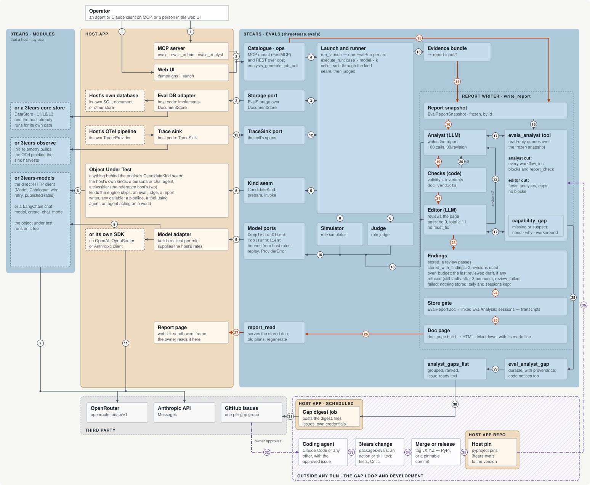

# Evals architecture

This page shows how `3tears-evals` sits inside a host app: the engine, the ports the host fills, the report writer, and the offline loop that turns a capability the report writer lacked into a change to 3tears. The [root README](../README.md#evals-as-the-worked-example) has the simplified picture; this page has every arrow.

## Ports

`3tears-evals` depends on no other 3tears package, only `httpx` and `pydantic`. Each thing it needs from the host is a port. The host can fill every port with its own system, and some ports with a 3tears module; the table says which.

| Port | Fill it with your own | Or with 3tears |
|---|---|---|
| `DocumentStore` (storage) | An adapter over your database, or evals' in-memory or SQLite store | A store over `threetears.core` (designed; no adapter ships yet) |
| `TraceSink` (tracing, optional) | A sink over your OpenTelemetry pipeline | A sink over the pipeline `threetears.observe`'s `init_telemetry` builds |
| `CompletionClient` (model calls) | A client over your own SDK, or evals' own `Model` | 3tears-models, once [#1013](https://github.com/pacepace/3tears/issues/1013) moves the client there |
| `CandidateKind` (what is evaluated) | Your production code: a chat agent, a classifier | The kinds evals ships: any function, a judge, the analysis reporter |

[Adopting the engine](../packages/evals/docs/adopting-a-host.md) is the full host guide.

## The diagram

<a href="images/evals-architecture-light.svg">
<picture>
  <source media="(prefers-color-scheme: dark)" srcset="images/evals-architecture-dark.svg">
  <source media="(prefers-color-scheme: light)" srcset="images/evals-architecture-light.svg">
  
</picture>
</a>

The diagram is evals as designed, not as `develop` has it today. On `develop`, `analysis_generate` and `report_read` (arrows 15 and 26) already write and serve a report, without the frozen snapshot or the analyst and editor loop (14, 16–25), which are on the `report-kit/analyst` branch. The gap loop (28–36) is designed but not built, and moving the model client into 3tears-models is [#1013](https://github.com/pacepace/3tears/issues/1013).

- **Boxes:** the host app's zones have a solid outline and a tan fill; 3tears' zones have no outline and a blue fill; a dashed box is one of the host's choices; a hatched zone with a dash-dot outline is outside any run.
- **Arrows 1–13** run a question as cells. **14–27** turn the evidence into a stored, reviewed report the owner reads; the thick orange arrows are the report's own path. **28–36** (dash-dot, purple) turn a capability the report writer lacked into a change to 3tears.

Click the diagram for full size. `python docs/images/evals_architecture.py` regenerates it.

## Every arrow

### Asking and running

1. The question, from an agent or Claude client on the MCP tools, or a person in the web UI.
2. Each call reaches its catalogue action: `campaign_create` declares the question; `run_launch` is priced, admitted and returns a job id.
3. Every engine read and write crosses the storage port to the host's adapter (`DocumentStore`), over the host's own database or a 3tears core store.
4. `run_launch`'s job: one `EvalRun` per arm.
5. One cell per test case × model × k, across the kind seam (`CandidateKind.prepare`, `invoke`) to the object under test.
6. The object under test's own model calls, for example a persona's chat turns on a 3tears-models chat model.
7. 3tears-models calls the provider.
8. User turns to voice (one `ActorPolicy` each), and cell output to score against the rubric.
9. The model ports call the host's model adapter, which builds the client and supplies the host's rates for the engine's cost bounds.
10. `generate()` on the model ports: a prompt in, a `Completion` out (text or JSON, usage, cost and its source).
11. Or the host's own SDK client calls the provider directly.
12. Spans flow from the OpenTelemetry pipeline (the host's own, or one 3tears observe built) through the trace sink into the runner, stored per cell.
13. Each cell's result and trace, read back per campaign as one evidence bundle.

### The report writer

14. The evidence is frozen whole as a report snapshot, by id.
15. `analysis_generate`'s job runs the report writer on the snapshot, on the host's analyst-role client and report budget.
16. The analyst's brief; the read-only analyst tool reads the same frozen snapshot.
17. Tool calls and their results, for the analyst and for the editor, each on its own cut of the tool.
18. Their model turns go through the same model ports, each admitted against the report budget first.
19. The analyst submits a report doc, checked in code.
20. A faulty submission bounces back to the analyst, a bounded number of times.
21. A clean draft goes to the editor, with nothing from the analyst's session.
22. A failing review goes back, and the analyst revises, a bounded number of times.
23. The loop ends: stored, stored with findings, or another ending.
24. A storing ending re-checks the doc, stores it, and links it to its analysis.
25. The doc page is built, with each arm's cost beside its quality.
26. `report_read` serves the newest stored doc's page.
27. Static HTML in a sandboxed iframe: the page the owner reads. Agents read the same report over MCP.

### The gap loop

28. When the analyst or editor lacks a capability, or a result looks wrong, it records a gap and carries on.
29. `analyst_gaps_list` groups the gaps, ranks them, and writes issue-ready text.
30. The host's scheduled job reads the digest.
31. It files a GitHub issue per group, with its own credentials. The engine calls neither.
32. The owner approves the issue, and a coding agent takes it up in an interactive session, outside any run.
33. It changes `packages/evals` in this repo: a new analyst action or skill text, with tests and an independent review.
34. The change is merged, and released or left as a pinnable commit.
35. The host moves its `3tears-evals` pin.
36. The new capability ships inside the package to the next report.
